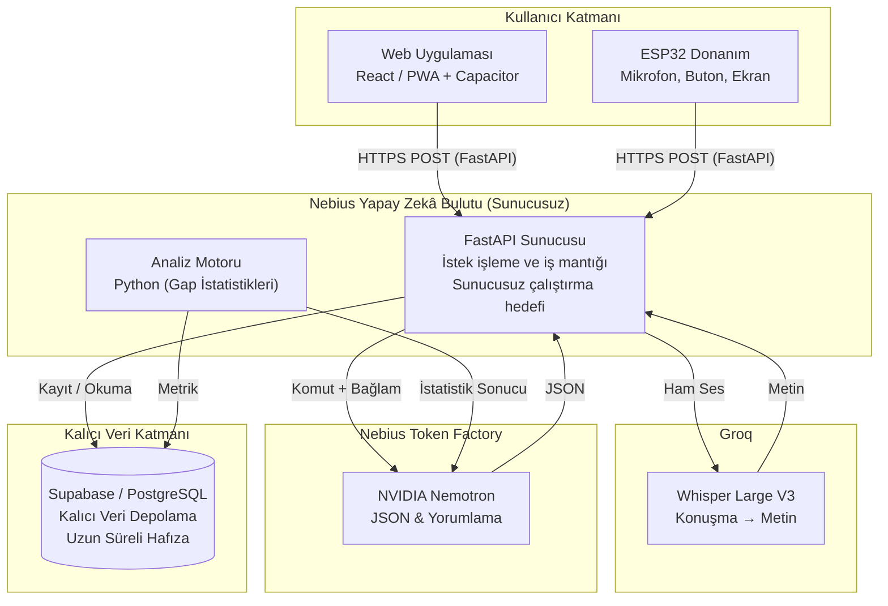

# GAP: Sistem Mimarisi

*Bu belge, GAP sisteminin bileşenlerini, veri akışını ve Nebius/NVIDIA altyapısı, Groq ses tanıma hizmeti ve barındırma yaklaşımını anlatır.*

> **Hedef mimari:** Bu belge tasarlanan sistemi açıklar; bileşenlerin tamamının depoda uygulanmış olduğu anlamına gelmez. Ortak API için `docs/api-contract.md`, AI çıktısı için `ai/schema.json`, alınan kararlar için `docs/decisions.md` geçerlidir. Web istemcisi React'tir. Ses mono PCM/WAV, 16 kHz, 16-bit ve en fazla 10 saniyedir. TTS, MVP için isteğe bağlıdır.

## 1. Genel Mimari Şeması

## 2. Bileşenler

### 2.1 Kullanıcı Katmanı

Bu katman yalnızca veri toplar ve gösterir; iş mantığı içermez.

- **Web Uygulaması:** React ile geliştirilmesi kararlaştırılmıştır. Kullanıcıdan yazılı girdi ya da mikrofonla sesli girdi alır ve analizleri gösterir. Capacitor ile mobil paketleme bir proje hedefidir.
- **ESP32:** I2S mikrofonla mono PCM/WAV, 16 kHz, 16-bit ses kaydeder; kayıt en fazla 10 saniyedir. Kaydı HTTPS üzerinden FastAPI'ye gönderir. Fiziksel butonlarla (yapıldı, ertelendi, atlandı) planın durumunu bildirir.

### 2.2 Sunucu Katmanı (FastAPI)

Sistemin istek yöneticisi ve iş mantığı katmanıdır. FastAPI uygulamasının Docker konteyneri olarak paketlenmesi hedeflenir; API sunucusunun sürekli açık kalacağı varsayılmaz.

- **API Geçidi:** İstemcilerden gelen HTTP(S) isteklerini (/parse, /voice, /plans/{id}/outcome) karşılar.
- **Akış Yöneticisi:** Gelen sesi önce konuşma tanımaya (Whisper) gönderir, ardından Uzun Süreli Hafızadaki geçmiş davranışlarla birleştirip dil modeline (LLM) iletir.
- **GAP Analiz Motoru:** Yapay zekânın yapmaması gereken matematiksel hesapları (uyum yüzdesi, hangi gün ve saatlerde erteleme yapıldığı, gecikme süresi) yapar.
- **Zamanlanmış Görevler:** Zamanlayıcı işleri API sunucusundan ayrı zamanlanmış görevler olarak çalışır.
- **Geçici Veri:** İstek sırasında gereken ses ve metin ara sonuçları bellekte tutulabilir. Kalıcı kullanıcı ve plan verileri Supabase/PostgreSQL'de saklanır; sunucu belleği kalıcı depolama değildir.

### 2.3 Yapay Zekâ Katmanı (Groq ve Nebius Token Factory)

Ses tanıma doğrudan Groq API'si üzerinden Whisper Large V3 modeliyle, dil modeli ise Nebius Token Factory üzerinden NVIDIA Nemotron ile çalışır. İkisi de REST API ile çağrılır.

- **STT (Konuşmayı Metne Çevirme) — Whisper Large V3:** Groq API'sinde çalışır; kullanıcıdan gelen WAV ses dosyasını yazıya dönüştürür.
- **TTS (Metinden Sese) — Groq + TTS.ai Fallback:** Birincil sağlayıcı olarak Groq (`canopylabs/orpheus-v1-english`, ses: `autumn`), yedek sağlayıcı olarak TTS.ai (`kokoro`, ses: `af_heart`, taban URL: `https://api.tts.ai/v1/`) kullanılır. Groq 429 kota aşımı veya geçici kesinti yaşadığında `TTS_AI_API_KEY` yapılandırılmışsa otomatik olarak TTS.ai yedeğe geçer. Her iki sağlayıcı da başarısız olursa plan kaydı/onayı bozulmaz ve güvenli JSON yanıtına düşülür.
- **LLM (NVIDIA Nemotron):** **Girdiyi Ayrıştırma** — Metni alır ve JSON şemasıyla kısıtlanmış yapılandırılmış bir çıktıya (niyet, tarih, saat, kategori) dönüştürür. **Yorumlama** — Analiz motorunun ürettiği sayıları okur (örn. "%67 uyum, salı günleri erteleme") ve kullanıcıya doğal dille, uygulanabilir bir öneri yazar.

### 2.4 Veri Katmanı (Supabase / PostgreSQL): Kalıcı Veri Depolama

Kalıcı veriler yalnızca burada saklanır. Modelin veritabanına doğrudan erişimi yoktur; tüm erişim FastAPI üzerinden yapılır. Bu katman sistemin Uzun Süreli Hafızasıdır.

- **users:** Kimlik bilgisi, saat dilimi ve yetkilendirme (Auth) anahtar özetleri.
- **plans:** Planlanan niyetler, başlangıç ve bitiş zamanları.
- **outcomes:** Kullanıcının eylemleri (yapıldı, ertelendi, atlandı) ve gerçekleşme zamanları.
- **personalization_profiles:** Kullanıcının açıkça girdiği onboarding/profil cevapları. Yaş aralığı saklanır; doğum tarihi ve konuşma dökümü saklanmaz.
- **suggestions / recommendation_feedback:** Plan başına saklanan öneriler ve kullanıcıya özel öneri geri bildirimi.

### Depolama Türlerinin Karşılaştırması

|  | Geçici Depolama | Kalıcı Depolama |
|---|---|---|
| Yer | Nebius sunucusu (bellek / önbellek) | Supabase / PostgreSQL |
| Ne tutar? | Oturum, ara sonuçlar, istatistik önbelleği | Kullanıcılar, planlar, sonuçlar, geçmiş davranış |
| Ömrü | Sunucu yeniden başlayana kadar | Silinene kadar süresiz |

## 3. Temel Veri Akışları

### Akış A: Plan Oluşturma

1. **Girdi:** Kullanıcı web uygulamasına metin girer veya ses kaydeder. ESP32 ses kaydını FastAPI'nin `POST /voice` adresine gönderir.
2. **Web akışı:** Web akışında metin veya ses girdisinin transkripti `POST /parse` adresine gönderilir. Transkriptin nasıl üretildiği bu belgede tanımlanmaz.
3. **Ayrıştırma:** Backend girdiyi `ai/schema.json` dosyasına göre doğrulanmış bir `ParsedPlan` nesnesine dönüştürür. `intent` değeri `clarify` ise istemci `clarification_question` alanını gösterir ve plan oluşturmaz.
4. **Web kaydı:** Kullanıcı `create_plan` sonucunu onayladıktan sonra istemci `POST /plans` ile planı kaydeder.
5. **ESP32 kaydı:** `POST /voice`, `create_plan` sonucu için planı kaydeder. `clarify` veya `unsupported` sonucu için plan kaydedilmez.

### Akış B: GAP Analizi ve İstek Üzerine Plan Önerisi

1. **Eylem Bildirimi:** ESP32'de bir butona basılır (örn. uzun basış = atlandı) ve POST /plans/{id}/outcome çağrılır.
2. **Metrik Güncelleme:** FastAPI sonucu Supabase'e yazar. Python analiz motoru kullanıcının yeni başarı oranını ve erteleme örüntüsünü hesaplar; sonuçlar geçici depolamada önbelleğe alınır.
3. **Plan önerisi:** My Plans ekranı plan başına öneri endpoint'ini sayfa açılırken çağırmaz. Kullanıcı plan kartından öneriyi istediğinde `GET /plans/{id}/suggestion` kayıtlı öneriyi döndürür veya uygun koşullarda ilk öneriyi üretip kaydeder. Yeni outcome varsa sonraki istek eski öneriyi yenileyebilir.
4. **LLM Yorumu:** FastAPI, hesaplanan net sayıları Nemotron'a gönderir ve "Bu verilere dayanarak kısa bir öneri yaz" der.
5. **Öneriyi Sunma:** Kaydedilen öneri My Plans'te yalnızca kullanıcı istediğinde gösterilir. Önerilen plan zamanı kullanıcı ayrı bir onay verirse mevcut `PUT /plans/{id}` ile güncellenir.

### Akış C: Insights önerileri ve plan onayı

`GET /insights` kullanıcının kimliğine göre plan/outcome geçmişini, personalization profile cevaplarını ve öneri feedback kayıtlarını okur. Behavior adayları yalnızca yeterli gerçek outcome verisinden çıkarılır. Contextual adaylar yalnızca girilmiş deadline/exam/goal tarihleri, kullanıcının belirttiği müsaitlik, gerçekten yaklaşan bir plan veya gerçek weather API yanıtına dayanır. Weather entegrasyonu en yakın gelecek plansa istek başına en fazla bir forecast sorgular ve mevcut sabit Üsküdar uygulama varsayılanını kartta açıklar; bu kullanıcı konumu olarak saklanmaz. Scheduler veya sürekli izleme yoktur.

Backend policy toplamı üç kartla sınırlar; varsayılan dağılım behavior/contextual/discovery için birer karttır ve boş kalan yerleri mevcut adaylarla doldurur. Kaynak ve sabit kimlikten SHA-256 dedup anahtarı üretilir. `recommendation_feedback` içindeki dismissal 30 gün gizler; useful/not-useful geri bildirimi sonraki seçim sırasını etkiler. Policy deterministiktir ve LLM çağırmaz. `recommendation_frequency=off` hem Insights kartlarını hem plan başına öneri endpoint'ini kapatır; diğer sıklık seçenekleri saklanır ama zamanlanmış teslimat oluşturmaz.

Contextual ve behavior kartları planı kendiliğinden değiştirmez. Discovery fikrini My Plans'e eklemek için kullanıcı onayı gerekir. Plan başına önerinin önerdiği yeni saat, kullanıcı onayı verdiğinde mevcut `PUT /plans/{id}` çağrısıyla kaydedilir. Profil alanı silme yalnızca seçili cevabı temizler; profil reset yalnızca `personalization_profiles` satırını siler ve plan/outcome/suggestion/feedback kayıtlarını korur. Kullanıcıya ait profil, plan, outcome, öneri, feedback ve ilişkili analiz verisini temizlemesi hedeflenen `DELETE /me/data` endpoint'i henüz uygulanmamıştır.

### Veri ve migration dağıtımı

Kod deposundaki migration dosyalarının bulunması Supabase'te uygulanmış olduğu anlamına gelmez. `20261013_001_gate1_core.sql`, `20261018_002_suggestions.sql`, `20261026_003_refresh_suggestions.sql`, `20261026_003_personalization_profile.sql` ve `20261026_004_recommendation_feedback.sql` hedef veritabanında gözden geçirilmeli ve sıralı/kontrollü uygulanıp SQL doğrulama testleri çalıştırılmalıdır. Mevcut GitHub migration job'u yalnızca core, suggestions ve refresh migration'larını çalıştırır; profile ve feedback migration'ları CI'da henüz uygulanmıyor. Phase 3B contextual policy için yeni bir migration gerekmez; mevcut profile ve feedback tablolarını okur.

## 4. Altyapı ve Dağıtım

- **Barındırma:** Nebius Yapay Zekâ Bulutu (sunucusuz uç noktalar).
- **Paketleme:** FastAPI uygulaması bir Dockerfile ile paketlenir.
- **Çalışma Şekli:** API sunucusu gelen istekleri karşılar; zamanlayıcı işleri API sunucusundan ayrı zamanlanmış görevler olarak çalışır.
- **Ölçekleme:** İstek sayısı artınca sunucusuz yapı kopya sayısını otomatik artırır, azalınca düşürür.
- **Depolama:** Geçici veriler Nebius tarafında, kalıcı veriler Supabase'te tutulur. Sunucu yeniden başlasa bile kalıcı veriler etkilenmez.
- **Dış Bağlantılar:** Sistem yalnızca dışarıya (Supabase, Nebius Token Factory, Groq, hava durumu API'si) REST istekleri gönderir; sunucu içinde kalıcı durum tutulmaz.
